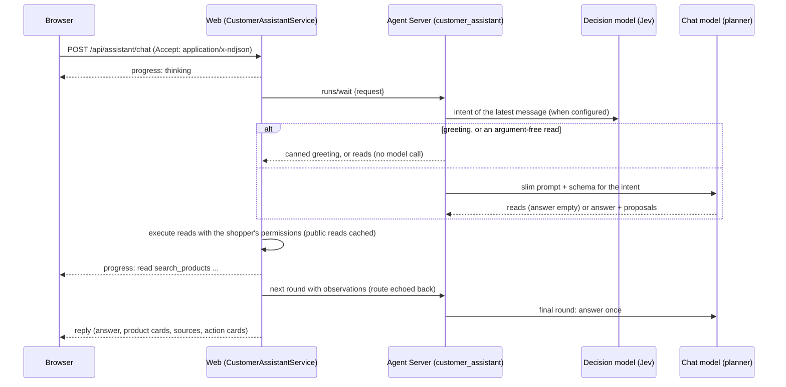

# Customer assistant

Shoppers open it with **Hỏi Agent** on the home page or the floating launcher, from the menu, at `/assistant`, or with
**Ask about this product** on a product page. The conversation lives in memory for the browser session: it is never
written to `localStorage` and is cleared when the account changes or the shopper starts a new chat.

## What it does

- Finds and filters kits by need, budget, brand, grade, scale, series, condition and channel.
- **Deep research** reads several products, their specifications and reviews, then compares them with in-shop sources.
- Prepares bag, wishlist and coupon changes, page navigation, contact messages, reviews of real experiences, profile
  edits, order cancellations, return requests and checkout (deposit of at least 10% or full payment).
- Sign-in, sign-up and password changes go through the existing secure forms.

Every action is an editable card the shopper reviews and confirms; the assistant never executes anything. Contact and
review drafts are editable, the star rating is the shopper's, and the API still checks that a reviewed order was
delivered. Checkout uses server prices and stock; if they changed after the preview, the shopper confirms again.

## How a turn runs

The web owns the loop: at most 3 read rounds (5 in deep research), 4 reads per round, 180 s per turn. The graph has
no tools, Store access, internet or write credentials; private reads always take the user id from the session.

## Speed, cost and capacity

| Technique | Where | Effect |
|---|---|---|
| Decision-model routing (TypeSafe Jev, `llm.decide`) | `graphs/customer_assistant.py` | ~100 ms intent choice instead of a planner round for greetings and argument-free reads; information-only intents get a prompt and schema without the action rules |
| Answer written once | planner schemas | read rounds leave `answer` empty; the last round has no `reads` field |
| Static prompt first | planner prompt | provider prompt caching reuses the shared prefix across shoppers |
| Facts sent once | `CustomerAssistantService` | observations refer to products by id; the catalog window (12) carries their facts |
| Public read cache (60 s) | `CustomerAssistantService.read` | searches, details, reviews and filters shared by all shoppers; private reads never cached |
| Reply cache + single flight | `CustomerAssistantService.chat` | a guest's first question with an empty bag is answered once per `ASSISTANT_REPLY_CACHE_SECONDS`; identical questions in flight share one run; replies with proposals are never shared |
| Keep-alive | web -> Agent Server | no new connection per round |
| Concurrency | `--n-jobs-per-worker` (Agent Server), `ASSISTANT_MAX_CONCURRENT` + queue (web) | shoppers no longer wait for each other; extra turns queue for `ASSISTANT_QUEUE_SECONDS` before "busy" |
| Streamed progress | NDJSON response, `AssistantConversation` | the shopper sees each step (searching, reading reviews, writing) instead of a spinner |

Every turn logs one line: rounds, time, intent and tokens (input, cached, output). The caches are per web process; with
several web instances, move them to a shared store (Redis).

Without `TYPESAFE_API_KEY` routing is off and every turn goes to the planner with the full prompt; everything else
above still applies.

## Configuration

| Variable | Default | Meaning |
|---|---|---|
| `LLM_PROFILE` | `local` | planner model profile (`config/llm/<profile>.yaml`); the Docker stack uses `openrouter-fast` |
| `TYPESAFE_API_KEY`, `DECISION_MODEL` | unset, `jev-latest` | decision-model routing |
| `AGENT_JOBS_PER_WORKER` | 16 | concurrent runs in the Agent Server |
| `ASSISTANT_MAX_CONCURRENT` | 16 | turns running at once per web process |
| `ASSISTANT_QUEUE_SECONDS` | 15 | wait for a slot before answering "busy" |
| `ASSISTANT_RATE_LIMIT` | 60 | turns per IP per 10 minutes (one at a time) |
| `ASSISTANT_REPLY_CACHE_SECONDS` | 300 | shared guest replies; 0 turns them off |

`AGENT_SERVER_URL` and `AGENT_ACTOR_SECRET` connect the web to the Agent Server; the secret must match on both sides.
The `customer` token runs only the `customer_assistant` graph as `customer:user:<id>` or a random guest identity, never
the `shop` identity, and cannot read admin threads or the Store.

## Tests

- Web unit: `tests/unit/customer-assistant.test.ts`, `tests/unit/customer-assistant-actions.test.ts`.
- Web DB: `tests/db/customer-assistant-checkout.test.ts` (a throwaway database whose name ends in `_test`).
- Browser: `e2e/customer-assistant.spec.ts` (mocked API; no real orders, messages or reviews).
- Agent: `tests/graphs/test_customer_assistant.py` (routing, shortcuts, schemas, usage), `tests/unit/llm/test_decision.py`.

To try a real model, run both services and ask: "Tìm mô hình dưới 1 triệu", "So sánh hai mẫu này",
"Chính sách đổi trả thế nào?", "Giúp mình chuẩn bị thanh toán".
